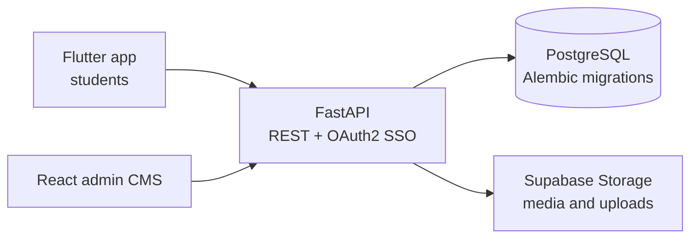

# ESEA Student and Admin Management Platform

Full-stack academic platform for the Environmental Science and Engineering Association (ESEA) at IIT Bombay: a Flutter student app, a React admin CMS and a FastAPI backend.

## Components

| Part | Folder | Stack |
|---|---|---|
| Student mobile app | `esea_frontend/esea_app` | Flutter (Dart), Dio, Provider |
| Admin CMS | `esea-admin-panel` | React, Vite |
| API | `esea-backend` | FastAPI, SQLAlchemy, PostgreSQL, Alembic |

## Features

- **Role-based access** for three roles: student, admin and alumni.
- **Institute SSO** via OAuth2, plus password login for admins.
- **Personalised timetable:** Python services build each student's timetable from department course lists and slot-to-time mappings (`app/services/timetable_service.py`, `student_timetable_service.py`) and manage exam timetables.
- **Admin CMS** with modules for course info, content and materials, discussion moderation, internship moderation, alumni management, exam timetable and slot-time uploads, ESEA ID CSV upload, feedback and audit logs.

## Architecture



## Run locally

```bash
# API
cd esea-backend
python -m venv venv && source venv/bin/activate
pip install -r requirements.txt
cp .env.example .env            # set DATABASE_URL, SECRET_KEY, SSO and Supabase values
alembic upgrade head
python run.py

# Admin CMS
cd ../esea-admin-panel
cp .env.example .env            # set VITE_API_BASE_URL
npm install && npm run dev

# Student app
cd ../esea_frontend/esea_app
flutter pub get && flutter run
```

`esea-backend/render.yaml` contains a Render deployment blueprint. There is no automated test suite yet.

## Notes

- Secrets are read from environment variables (`SECRET_KEY`, `SSO_CLIENT_SECRET`, `DATABASE_URL`, `SUPABASE_SERVICE_KEY`); never commit real `.env` files.
- Sample spreadsheets in the repo root (course lists, slot times) show the expected upload formats.
